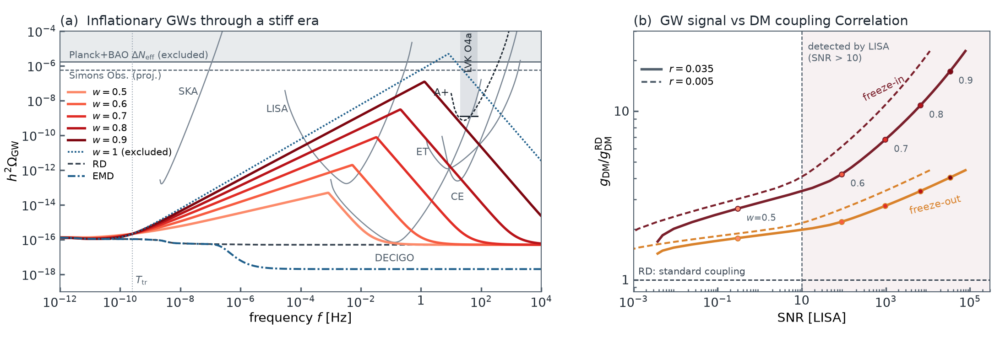

# TomoCosmo (prototype v0.1.0)

**Gravitational-wave tomography of the pre-BBN Universe**

This prototype of TomoCosmo computes **one expansion history** of the early Universe and uses the same history for
two observables:

* the **inflationary gravitational-wave (GW) background**: today's spectrum `h²Ω_GW(f)` and its
  signal-to-noise ratio (SNR) in future detectors (LISA, DECIGO, ET, CE, LIGO A+, an SKA-like PTA);
* **dark-matter (DM) production**: the freeze-out cross section and the freeze-in decay width that
  give the observed abundance `Ωh² = 0.12`.

Both are compared with standard radiation domination (RD). A non-standard era (a stiff era with
equation of state `w`, a generic `w(T)`, or an early matter era with entropy injection) changes the
GW spectrum and the required DM coupling together; TomoCosmo turns that into a relation between a
GW observable and a laboratory observable (Fig. 1 below).

This repository is the research prototype behind the preliminary results of the project.
Author: **Satyabrata Mahapatra** (School of Physical Sciences, IIT Goa).



*(a) Inflationary GW spectrum for RD, stiff eras of w = 0.5–0.9, w = 1 (excluded) and an early
matter-dominated era, with current bounds (shaded) and projected sensitivities. (b) DM coupling
required for Ωh² = 0.12, relative to RD, against the LISA SNR of the same history (each point is
one w; solid r = 0.035, dashed r = 0.005).*

## Contents

| File / folder | What it does |
|---|---|
| `tomocosmo_proto.py` | Core module. Constants, SM `g*(T)`, the `Background` class (RD, stiff era, **generic `w(T)`**, early matter domination with entropy injection), DM freeze-out and freeze-in. The file header describes the whole program. |
| `gwsources.py` | Inflationary tensor spectrum `h²Ω_GW(f)` on any `Background`. |
| `detectors.py` | Detector noise curves (with the sources of each projection), power-law-integrated sensitivity curves, SNR. |
| `validation.py` | Checks the RD results against analytic formulae before any ratio to RD is formed. |
| `compute_snr_vs_w.py` | Scans `w`: SNRs and DM rate ratios → `data/snr_vs_w.json`. |
| `make_fig1.py` | Draws Fig. 1 → `figures/`. All settings (physics, colours, labels, legend, limits) are at the top, with a table saying what to change where. |
| `make_sensitivity_curves.py` | Regenerates `data/sensitivity_curves.npz` from `detectors.py`. |
| `tests/test_tomocosmo.py` | Automatic checks. |
| `data/lal_tables.npz` | ET, CE and A+ noise curves and detector geometry taken from LALSuite, so LALSuite is not required. |
| `data/sensitivity_curves.npz` | Power-law-integrated curves (SNR = 10) for all detectors. |
| `data/snr_vs_w.json` | Output of `compute_snr_vs_w.py`. |

## Installation

Python 3.9 or later.

```bash
git clone https://github.com/cap-cq/TomoCosmo.git
cd TomoCosmo
python3 -m venv .venv
source .venv/bin/activate          # Windows: .venv\Scripts\activate
pip install -r requirements.txt
```

## Quick start

```bash
python3 validation.py              # RD checks (1 s)
python3 compute_snr_vs_w.py        # scan over w (about 30 s)
python3 make_fig1.py               # Fig. 1 (about 30 s)
python3 -m pytest tests            # automatic checks
```

Use the library directly:

```python
import numpy as np
import tomocosmo_proto as tc, gwsources as gs, detectors as dt

# a stiff era with w = 0.7 between T_K = 1 TeV and T_tr = 10 MeV
bg = tc.Background("stiff", T_ini=1e13, npts=16000, T_tr=0.01, T_K=1e3, w=0.7)

f = np.logspace(-12, 4, 700)                                  # Hz
spectrum = gs.omega_inflation(bg, f, r=0.035)                 # h^2 Omega_GW today
print(dt.snr("LISA", lambda x: gs.omega_inflation(bg, x)))    # SNR in LISA

bg_dm = tc.Background("stiff", T_ini=1e6, npts=12000, check_start=False, T_tr=0.01, T_K=1e3, w=0.7)
print(tc.sigv_required(bg_dm, m=10.0))                        # cm^3/s for Omega h^2 = 0.12
print(tc.freeze_in_gamma(bg_dm, m_dm=0.1, m_B=10.0))          # GeV
```

### A generic equation of state w(T)

```python
def my_w(T):                      # w of the extra component at plasma temperature T [GeV]
    return np.where(T > 1e3, 0.0, 0.7 + 0.1 * np.tanh(np.log10(T)))

bg = tc.Background("w_of_T", T_ini=1e13, npts=16000, w_of_T=my_w, T_norm=0.01, ratio_norm=1.0)
```

The component obeys `d ln ρ_X / d ln a = −3(1 + w(T))` and is normalised by `ρ_X/ρ_r = ratio_norm`
at `T = T_norm`. It must not exchange energy with the plasma; for a decaying species use
`kind="emd"`.

## Checks of the RD results

`validation.py` (also run at the start of `compute_snr_vs_w.py`, which stops if a check fails):

| Quantity | TomoCosmo | Reference |
|---|---|---|
| entropy conservation `s a³ / s₀` | 1 to 10⁻⁴ | 1 |
| tensor plateau, r = 0.035 | 4.92 × 10⁻¹⁷ | analytic RD formula |
| tilt in a w = 0.7 era | 0.7095 | 2(3w−1)/(1+3w) = 0.7097 |
| freeze-out ⟨σv⟩, m = 10 GeV | 2.24 × 10⁻²⁶ cm³/s | 2.2 × 10⁻²⁶ cm³/s (standard value); semi-analytic 2.15 × 10⁻²⁶ |
| freeze-in Γ, 10 GeV → 0.1 GeV DM | 7.52 × 10⁻²³ GeV | analytic yield 7.80 × 10⁻²³ GeV |

## Physics notes

* Natural units (GeV) internally, frequencies in Hz, `a = 1` today.
* **Stiff-era history** (`kind="stiff"`): RD → a matter-like phase → stiff era of constant `w` from
  `T_K` → RD from `T_tr` (the fluid equals radiation at `T_tr`). A stiff fluid redshifts faster than
  radiation, so it can only dominate if it was matter-like before; the matter-like phase plays that
  role. For `w` close to 1 the matter-like phase starts at very high temperature, and
  `T_ini_stiff()` raises the start of the grid accordingly.
* **Couplings in Fig. 1(b)**: freeze-out through a mediator heavier than the DM with fixed mass and SM
  coupling, so `⟨σv⟩ ∝ g_DM²` and `g/g_RD = (⟨σv⟩/⟨σv⟩_RD)^(1/2)`; freeze-in from a two-body decay,
  `Γ ∝ g_DM²` and `g/g_RD = (Γ/Γ_RD)^(1/2)`. The SNR scales linearly with `r`.

## Simplifications of this prototype

* Horizon re-entry is instantaneous; the spectrum is not smoothed by the full transfer function.
* Scale-invariant tensors (`n_T = 0`); no damping by free-streaming neutrinos.
* The change of `w` at `T_K` is instantaneous, and the stiff fluid does not exchange energy with
  radiation; its energy density is analytic, not solved from a scalar-field equation.
* Early matter domination: the decay width is set by `Γ_X = H_RD(T_RH)`.
* Freeze-out: constant s-wave ⟨σv⟩, Maxwell–Boltzmann statistics, two internal degrees of freedom.
* Freeze-in: the parent is in equilibrium, Maxwell–Boltzmann statistics, no inverse decays, one DM
  particle per decay.
* Detectors: design or projected sensitivities, no foregrounds; the LISA and DECIGO normalisations
  follow one convention among several that differ by factors of about √2. The SKA-like PTA is an
  illustrative white-noise model.
* Not yet included: cosmological phase transitions, domain walls and cosmic strings evolving during
  a non-standard era, PBH-dominated histories, and the inference module. These are planned for later
  versions.

## How to cite

If you use TomoCosmo, please cite this repository (see `CITATION.cff`).

## Licence

MIT, see `LICENSE`.
